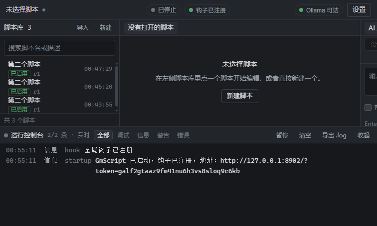

# GmScript 2.0 · 本地 AI 宏脚本工作台

把关键操作（按什么键、点什么位置、什么时候循环）写成 Lua 脚本，用全局热键触发；
脚本可以让本机的 AI 帮你写。**界面在浏览器里，脚本与键鼠注入在本地 Java 进程里。**

```
浏览器（Vite + React + CodeMirror）
        │  REST + SSE（只绑 127.0.0.1，带启动令牌）
┌───────▼───────────────────────────────────────────────┐
│ Spring Boot 本地服务                                   │
│  api     脚本库 / 运行 / 热键 / 日志 / AI / 知识库 / 设置 │
│  service 用例层                                        │
│  kernel  input  全局钩子 · 注入通道 · 热键表 · 回声抑制   │
│          lua    沙箱 Globals · 单脚本单线程 · 协作事件泵  │
│          runtime 启停 · 宽限期看门狗 · 运行记录           │
│  store   SQLite（脚本/版本/热键/运行/日志/知识库/会话）    │
│  ai      Spring AI：Ollama（默认）/ 任意 OpenAI 兼容端点  │
└───────────────────────────────────────────────────────┘
        │ JNativeHook 全局钩子 · JNA SendInput 注入
     真实游戏/桌面
```

## 这一版为什么值得替换掉 1.x

1.x 能跑，但有几处是**结构性错**（都有代码行级证据，见 `docs/ADR-0001-rewrite-decisions.md`）：

| 旧版问题 | 后果 | 现在怎么处理 |
| --- | --- | --- |
| `JsePlatform.standardGlobals()` 里没有 `debug` 库，停止钩子从未装上 | `while true do end` 停不住、CPU 占满、停止按钮永不复位 | 沙箱换成 `debugGlobals()` + 指令钩子 + 中断 + 宽限期判 KILLED |
| 注入与钩子用了**两套按钮语义**（1/2/3 与 AWT 掩码 16/8/4） | 自己注入的点击被当成真实事件回灌，形成自激 | 注入前登记、钩子认领的精确回声抑制 |
| 钩子侧 2=右、3=中（libuiohook 实测），Lua 侧却按 2=中、3=右 解释 | `IsMouseButtonPressed(3)` 判断的是中键，右键永远 false | 边界处一次性翻译成规范语义（1=左 2=中 3=右） |
| F11/F12 用「F1 + n」推算（实际 59-68、87-88） | F11/F12 解析成 `unknown(87)`，过滤器失效 | 显式键码表，未映射一律 `unknown(N)` |
| 事件只在 `Sleep()` 里派发 | 不 Sleep 的脚本收不到 `OnEvent`；长按期间事件全堵 | 派发循环与阻塞 API 都泵事件 |
| 事件队列无界 | 脚本不让出执行权就 OOM | 有界队列 + 丢最旧 + 丢弃计数上报 |
| 停止后不释放已按下的键 | 「脚本停了 W 还按着」，且该键永久收不到事件 | 停止/结束/异常路径统一 `releaseAll()` |
| 根本没有热键绑定功能 | 只能按硬编码的 Ctrl+Shift+F12 急停 | 每脚本独立绑定、冲突检测、可配急停 |
| 只有单个编辑器缓冲 + `lastScript` 字符串 | 没有脚本库、没有多脚本 | SQLite 脚本库 + 版本 + 导入导出 |
| Lua 沙箱里带着 `os`/`io`/`luajava` | AI 生成的脚本可以执行任意系统命令 | 白名单沙箱：移除 `os/io/luajava/require/loadfile/dofile` |
| 本地 Ollama 也硬发 `Authorization: Bearer `（空 key），SSE 读超时设 0 | 挂起后聊天框永久锁死 | Spring AI 双通道 + 可取消 + 有限超时 |
| 语 i18n 缺续行符、钩子失败只写 stderr 而 exe 没有控制台 | 用户看不到任何失败信息 | 状态进 `/api/health`，界面顶部直接显示 |

## 快速开始

**环境**：JDK 21（本机 `E:\IntelliJ IDEA 2025.3\jbr` 是 21.0.8）、Node 20+、可选 Ollama（默认走本地）。
Maven 不必全局安装：仓库里没有 wrapper 时用 IDEA 自带的 `maven3`。

```bash
# 1. 前端（首次）
cd web && npm install && npm run build     # 产物直接落到 src/main/resources/static

# 2. 后端（开发期直接跑）
mvn -DskipTests package
java -jar target/gmscpt-2.0.0-SNAPSHOT.jar

# 3. 一步到位（前端 + 打包 + 尝试出 EXE）
powershell -ExecutionPolicy Bypass -File build-exe.ps1
```

启动后控制台会打印一行带令牌的地址，并自动打开浏览器：

```
http://127.0.0.1:8790/?token=xxxxxxxx
```

**关于 EXE**：`build-exe.ps1` 会自动找带 `jpackage` 的 JDK 21。本机 IDEA 自带的 JBR
**只有运行时、没有 jpackage**，所以第 3 步会打出 fat jar 后停在「跳过 EXE 打包」并给出指引——
这是预期行为，不是失败。要出 EXE 请装一个完整 JDK 21（Amazon Corretto 21 / Temurin 21）
并把 `JAVA_HOME` 指过去。脚本本身只含 ASCII：PowerShell 5.1 在无 BOM 时按本地代码页解析，
UTF-8 中文会直接变成语法错误（这个坑踩过）。

**令牌是必须的**：服务只监听回环，但浏览器里任何网页都能向本机端口发请求。
没有令牌，别的网页就能让你的电脑注入键鼠。令牌每次启动重新生成，前端存在 `sessionStorage`。

## 数据与配置

| 位置 | 内容 |
| --- | --- |
| `~/.gmscpt/gmscpt.db` | SQLite：脚本元数据、版本、热键、运行记录、日志、知识库、对话 |
| `~/.gmscpt/scripts/<id>.lua` | 脚本正文（真源，可用你自己的编辑器/git 管） |
| `src/main/resources/application.yml` | 端口、钩子与运行期限制、模型默认值 |

运行期可改项在界面「设置」里，落库后立即生效（AI 通道地址、模型、急停热键等）。
云端 API Key **只进不出**：写入后接口只回 `hasCloudApiKey`，不回密钥本身。

## Lua API

编辑器补全、AI 提示词、界面帮助三处共用 `GET /api/lua/api` 这一份事实源，
所以不会出现「文档里有、实际没注册」的漂移。函数与约定见
[`docs/api-contract.md`](docs/api-contract.md) 与 `LuaApiRegistry`。

脚本入口固定是：

```lua
function OnEvent(event, arg)
    if event == KEY_PRESSED and IsKeyPressed("f8") then
        OutputLogMessage("按下了 f8")
    end
end
```

顶层代码只做初始化；跑完顶层后进入事件派发循环，热键按下→启动脚本→脚本收事件，
和罗技 G 系列的语义一致。

## 验证

四层，从便宜到贵：

```bash
mvn test                       # 33 个单测：键码表/按钮语义/回声抑制/沙箱/死循环停止/热键规范化/思考链开关
bash scripts/smoke.sh          # 35 项端到端：起服务→鉴权→CRUD→运行→日志→知识库→设置→真 AI 流式
bash scripts/real-input-test.sh  # 真机：让脚本移动鼠标 200px，从系统侧读光标验证（会真的动鼠标）
bash scripts/hook-test.sh        # 真机：系统合成按键，验证钩子收到 + 热键能拉起脚本（会真的按键）
```

真机两个脚本会启动**隔离数据目录**的实例，不碰你的 `~/.gmscpt`，也不留数据。
它们验证的是自动化测试碰不到的东西：`SendInput` 是否真的驱动了光标、全局钩子是否真的收到系统按键。

实测结论（2026-10-27）：

| 层 | 结果 |
| --- | --- |
| `mvn test` | 33/33 |
| `smoke.sh` | 35/35 |
| `real-input-test.sh` | 5/5（光标 1260→1460，`dx=200 dy=0` 零漂移） |
| `hook-test.sh` | 5/5（真实按键的按下 `event=3` 与抬起 `event=4` 均收到） |

`smoke.sh` 的断言里有几条**踩过坑的回归项**：钩子注册、`/api/health` 响应时间、
默认模型能出字（不是 `think:true` 导致的 400）、设置响应不泄露 apiKey、热键表达式规范化。

仍然只能人工判断的：在**真实游戏**里的表现（反作弊、前台/后台）、打包 exe 在干净机器上跑、
云端 OpenAI 端点的真实应答。清单见 `docs/acceptance-checklist.md`。

已验证的界面：



左：脚本库 / 中：编辑器 / 右：AI 对话 / 底：实时日志，顶栏显示钩子、Ollama 与运行状态。

## 工程文档

| 文档 | 内容 |
| --- | --- |
| `docs/ADR-0001-rewrite-decisions.md` | 改造裁决、缺陷清单、安全红线 |
| `docs/api-contract.md` | 前后端接口契约 |
| `docs/architecture-target.md` | 目标架构（软件架构师评审稿） |
| `docs/backend-architecture.md` | 后端与表结构（后端架构师评审稿） |
| `docs/PRD-product.md` | 产品范围与验收标准（产品经理评审稿） |
| `docs/ui-design.md` | 界面令牌与组件规格（UI 设计师评审稿） |
| `docs/acceptance-checklist.md` | 真机验收清单与证伪方法 |

## 已知限制

- 仅 Windows：注入走 `SendInput`，`Robot` 兜底。
- 被判 KILLED 的脚本（宽限期内没停下来）会**弃用**那份 Lua 状态：不再触碰它，
  代价是泄漏一份 `Globals`。Java 无法安全强杀卡在原生调用里的线程。
- 事件队列容量、停止宽限期改了要重启才生效（AI 设置是热生效的）。
- 知识库目前是关键词检索；向量检索（`nomic-embed-text`）与脚本市场在二期。
- **JNativeHook 在 fat jar 里必须走自定义原生库定位器**：它的 `DefaultLibraryLocator`
  用 `new File(CodeSource.toURI())` 找 dll，而 Spring Boot 可执行 jar 里依赖的 code source 是
  `jar:file:...!/BOOT-INF/lib/...`（非分层 URI），会抛 `URI is not hierarchical`。
  `NativeLibraryLoader` 把 dll 解包到 `~/.gmscpt/native/` 绕过这个问题。
  如果哪天看到 `/api/health` 的 `hook.error` 又出现这句话，热键会全部失效。

## 从 1.x 迁移

旧版 Swing 界面（`com.gmscpt.{gui,core,input,lua,agent,config,knowledge}` 与 `App.java`，
32 个文件约 4000 行）已在本版**物理删除**，`flatlaf` / `gson` / `okhttp` 依赖同步移除。
`luaj` / `jnativehook` / `jna` 保留——内核还要用。

想找回旧实现的话，它完整保存在首个提交里：

```bash
git show fe0178c --stat          # 看当时都有什么
git checkout fe0178c -- src/main/java/com/gmscpt/gui   # 找回某个包（不建议，仅作对照）
```

旧版的知识库数据没有丢：`src/main/resources/knowledge/knowledge.json` 仍作为种子，
首次启动时（`kb_entry` 为空）导入数据库，之后可自由增删改。
